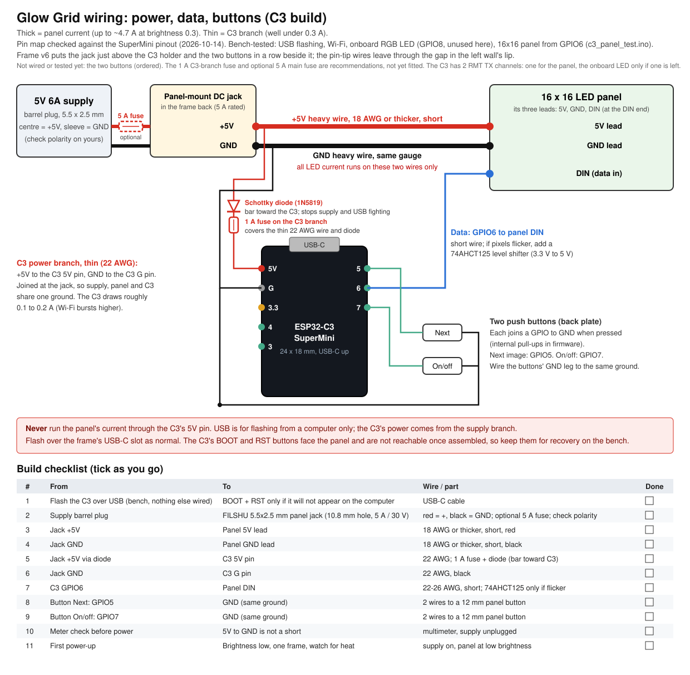

# glow-grid

Pixel art and animations for a **16x16 WS2812B LED panel** on a **Raspberry Pi 5**, driven over hardware SPI, plus **Glow Grid**, a browser-based pixel editor for designing them before they ever touch the panel.

Sister project to [led-strip](https://github.com/dwooods/led-strip), which drives a 1D strip with procedural effects. This one is about 2D images: draw, simulate, copy to the Pi, play.

## The workflow

1. **Design** in the Glow Grid simulator (`https://dwooods.github.io/glow-grid/`, installed as an app, or `web/index.html` locally), or in [Piskel](#piskel).
2. **Check and adjust**: tune *LED brightness* and *Gamma* (in *Panel settings*), and watch the *Panel check* (collapsed under *Panel settings*; its summary line shows the flag count), which flags pixels that will be barely lit or shift color (dashed outlines on the grid) and estimates current draw against your power supply. The grid shows your colors as drawn; the Panel check is what tells you how the LEDs will treat them.
3. **Export** from the *File* menu (*File ▸ Export…*). For the Pi it is one PNG: a still with 1 frame, an animation sprite sheet (frames side by side) with 2 or more. The file name is just the sprite's name (`knight.png`); the frame count, fps, brightness and gamma are stored inside the PNG.
4. **Copy** it to the Pi's `images/` folder and play it from the terminal: pick it in the `glow-grid` menu, or run `python3 play.py knight.png`. The Pi uses the same math and the image's own light settings, so the panel shows what the simulator showed.

The simulator never talks to the panel. It's a preview tool; the Pi's Python program is what lights the LEDs.

## The simulator

`web/` is a static site with no build step or framework: `index.html` holds the markup, `style.css` the styles, and `js/` the code, split by job and loaded in order (they share one scope, so there is nothing to bundle). The same folder is what GitHub Pages serves and what the future phone app (Capacitor) will wrap, so the simulator is written once and runs in three places.

| File | Job |
|---|---|
| `js/core.js` | helpers, saved settings and last session (`localStorage`), the blank starting frame |
| `js/led.js` | the LED model (mirrors `grid_common.py`: gamma, brightness, current estimate) and the shared layer |
| `js/editor.js` | undo/redo, rendering, frames, drawing (strokes are filled in between pointer samples so fast drags don't skip cells), the editing view |
| `js/loupe.js` | touch magnifier: a close-up of the pixels around a painting finger or pen |
| `js/phone.js` | phone layout (portrait): moves the tools into a bottom dock and the frame extras below the strip (More jumps to them), and puts everything back on rotate or resize |
| `js/import.js` | import, photo-to-grid (crop, background-off, dither), resize |
| `js/export.js` | the PNG text chunk (`glow-grid` metadata), the `.gg` sprite file for the C3, the Export dialog (Pi, view/share, C3), the Save-as picker and the status toast |
| `js/examples_data.js` | GENERATED by `examples/make_web_examples.py` from `examples/sprites.py`: the example sprites the Board card can add to a board (a test fails if it is stale) |
| `js/board.js` | the Board card and the Network dialog: talk to the ESP32-C3 player over USB (Web Serial, Chrome and Edge on a computer) or over Wi-Fi (the board's HTTP API, any browser that lets the page reach it): list, send the drawing, play, delete, panel off/on; the Network dialog sets the board's address and, over USB, its Wi-Fi name and password |
| `js/help.js` | the Help dialog text (kept out of `index.html` so page edits stay small) |
| `js/tools.js` | move, "edit all frames at once", playback |
| `js/main.js` | app install, service worker, File menu, boot |

**Tests:** `python3 -m unittest discover -s tests -v` (needs Node and Pillow; the Pi driver is stubbed, so it runs anywhere Linux/macOS/WSL). It checks that the simulator's gamma/brightness table equals `grid_common.py`'s, that a PNG saved by the simulator is read back correctly by the Pi code, that the example generator writes the same metadata, that the example sprites shipped to the Board card are the ones in `examples/sprites.py` and build to the same `.gg` bytes, that the editor's `.gg` export is byte-identical to `c3/tools/gg_format.py` and accepted by the board's own check, that the service worker caches every file the page loads, and the menu's delete helpers. Run it before pushing a change to `led.js`, `export.js`, `grid_common.py`, `index.html` or `sw.js`.

`tests/test_smoke.py` is a browser smoke test (import naming, Save with a stubbed picker, the ESP32-C3 `.gg` export, the Board card against a fake board that speaks the firmware's protocol (including five-per-page paging and Add/Remove examples), the same card over Wi-Fi against a fake HTTP board, the Network dialog's Wi-Fi setup over USB, a saved sheet restoring its frames, the Help dialog). Run it by hand before pushing a change under `web/`: `pip install playwright pillow && playwright install chromium`, then `python3 -m unittest tests.test_smoke -v` from the repo root. It skips itself if Playwright is missing.

New targets (BLE upload) go in `export.js`; new drawing tools go in `tools.js`. `index.html` should stay markup only; Help text lives in `help.js`.

- **On a phone** (iPhone Safari or Android Chrome, or installed to the home screen, portrait): the grid fills the width. A dock at the bottom stays put and holds Paint/Fill/Erase/Pick, your color (tap it to jump to the wheel), the palette and Undo/Redo; a frame strip sits under the grid (Play, thumbnails, duplicate, **More**). The rest (frame speed and delete, Move and layers, wheel and hex, Panel settings) is below the strip: swipe up anywhere except on the grid (a finger on the grid paints), or tap **More** to jump to it. While a finger or pen paints or erases, a magnifier shows the pixels around it. Touch targets are 44 px. The dock is used in portrait windows up to 900 px tall and on any touch device; a tall, narrow desktop window keeps the desktop layout, and landscape falls back to the scrolling page. With more frames than fit on one line, the strip wraps into the spare height under the grid (a single scrolling line when there is no room). This is a web app only for now; a native app is a later stage (see `claude/phone-app-design.md` in the project docs).
- **Open it locally**: double-click `web/index.html`. Everything works except app install.
- **Hosted**: every push to `main` that touches `web/` deploys it to GitHub Pages at `https://dwooods.github.io/glow-grid/` (see `.github/workflows/pages.yml`; app icons are generated in CI by `web/make_icons.py`). It is a project site, so it sits beside the blog at `dwooods.github.io` without touching it. One-time setup: *Settings → Pages → Build and deployment → Source: GitHub Actions*.
- **Test on a phone**: open the hosted page in Chrome or Safari on the phone; both use the same engine on an iPhone, so the layout and touch drawing match. Install and offline use are the Safari route. Reload once more after an update, because the service worker serves the cached copy first.
- **Install as an app**: open the hosted page in Chrome, Edge or iPhone Safari (*Share → Add to Home Screen*) and it runs in its own window and works offline. After an update, close and reopen it to pick up the new version.

## Tools and color

- **Paint, Fill, Erase, Pick.** Erase sets a pixel to pure black, which is "off" on the panel. Pick is an eyedropper: hover a pixel to see its color, click to make it the paint color, and the tool returns to Paint. Alt+click does the same without leaving the current tool.
- **Color wheel.** Hue goes around the wheel, saturation outward, and the *Shade* slider beside it sets how light or dark the paint color is (black at 0, the full color at 100). *Shade* only changes the color you paint with; it is not the *LED brightness* in *Panel settings*, which sets how bright the panel runs. The hex field accepts a typed color (`#1a73e8`).
- **Clear frame** blanks the current frame. **Start over** throws away every frame and the shared layer and leaves one blank frame; so does *Delete frame* on the last remaining frame. Undo brings them back. The page always opens on one blank frame; what you had last time is kept in this browser and the **Restore last session** link (on the hint line under the frame strip, shown while the frame is blank) brings it back. Undo goes back to blank. The *Frame n / N* readout appears once there are two or more frames, because a single frame already shows its number on the thumbnail.
- **Palette** holds ten fixed colors plus the last eight you used; a recent color that is almost the same as one already shown is skipped. **In this picture** lists the colors already in your frames, most used first, so touch-ups use the exact same values.

## Open (pictures and saved sprites)

*Open…* (in the File menu) turns any picture into a 16×16 design. A sprite sheet or one of the simulator's own saved frames loads directly; any other picture opens the import dialog. On a phone the file picker offers the camera too.

- **Crop and zoom:** drag the photo to move it, pinch or scroll to zoom. *Fit whole photo* shows everything (letterboxed); *Fill grid* crops to the grid's shape. The faint lines are one LED each, and the small picture is the result.
- **Exact pixels:** for small pixel art, tick *Exact pixels (pixel art, no averaging)*. Each LED takes the color at the middle of its cell, with no averaging or dithering. It is on by default for images no larger than twice the grid.
- **Flat art:** for illustrations, logos and clip art. It finds the picture's main colors (4 to 16; 8 by default) and gives each LED whichever one covers most of its cell, so outlines, anti-aliasing and JPEG noise never win a cell and the result is already in a small palette. It switches itself on when the picture is mostly a few flat colors. Small details (a nose, whiskers) that never fill half a cell drop out; add them back with Paint and *Pick*.
- **Background off:** tap *Pick on photo* (or *Use corners*) to choose the background color, then set the tolerance. Only the background connected to the picture's edge is removed, so white inside the subject (a face, an eye) stays. Background cells go black (LED off). Cells at the edge of the subject keep the subject's own color instead of a muddy blend. If the background leaks inside through a gap in an outline, lower the tolerance.
- **Dithering:** *Floyd–Steinberg* (smooth) or *Ordered* (patterned). It works in LED space, using the brightness and gamma from *Panel settings*, so dark gradients that would collapse into a few levels keep their tones. Black stays black. It is baked in at the current brightness and gamma; change them and re-run.
- *Apply to this frame* replaces the frame; *Add as new frame* appends one, so a few photos make an animation. Undo reverts.

The resize is an exact area average, the same math as the Pi's `BOX` filter, so a photo imported with no dithering matches what `play.py` would make of the original file to within one level of 255.

The LED model matches `grid_common.py` exactly: `round(255 * BRIGHTNESS * (c/255) ** GAMMA)`, with any non-zero channel kept at 1 or above.

### Light settings travel with the image

When you save a PNG, Glow Grid writes its current *LED brightness* and *Gamma* into the file (a PNG text chunk named `glow-grid`; the pixels are unchanged). On the Pi, `play.py` reads them and uses them for that image, and prints what it used:

```
knight.png: 4 frame(s), brightness 0.35, gamma 2.2 from the image
```

- The file name carries no settings. Frame count, fps, brightness and gamma are stored inside the PNG, so the Pi plays a sheet correctly under any name, and the menu lists them next to it, e.g. `knight.png  (4 frames, 4 fps, bright 0.35, gamma 2.2)`. The Pi's speed priority is the number you type, then the PNG, then `_4fps` in the name (for sheets made elsewhere).
- Images without them (Piskel exports, GIFs, photos, older Glow Grid saves) use `BRIGHTNESS` and `GAMMA` from `local_config.py`.
- `MAX_BRIGHTNESS` in `local_config.py` (default 0.4) caps every image, so a design saved at 0.9 can't overload a 6A supply. The Pi says when it capped one. Raise it only with a bigger supply.
- `USE_IMAGE_LIGHT = False` ignores the saved settings and always uses `local_config.py`.
- Importing a Glow Grid PNG back into the simulator restores its brightness and gamma too.
- Editing the PNG in another app may drop the settings; it then falls back to `local_config.py`.

### Animation files: sheets, fps and file names

An animation is a **sprite sheet**: one PNG with every frame side by side, like a strip of film. For a 16×16 panel it is 16 px tall and 16 px wide per frame, so 4 frames make a 64×16 image. The Pi cuts it into 16 px pieces and plays them in order. **fps** (frames per second) is how fast it plays: at 4 fps each frame shows for a quarter of a second. The sheet says *what the file is*; fps says *how fast to play it*.

```
[ frame 1 ][ frame 2 ][ frame 3 ][ frame 4 ]     = one 64x16 PNG, played at 4 fps
```

**Files saved from Glow Grid** (one export button: a still with 1 frame, a sprite sheet with 2 or more) store the frame count and fps inside the PNG, next to brightness and gamma, so the file name can be anything: `ghost.png`, `red_ghost_v2.png`. The saved name is just the sprite's name; the menu on the Pi shows the settings. They also record the grid size (`cols`, `rows`); if a file was made for a different size than the panel, the menu flags it (`! made for 8x32, panel is 16x16`) and `play.py` prints a note, rather than squashing it silently.

**Sheets from other tools** (Piskel, hand-made strips) carry no metadata, so the Pi uses the file name:

| File name | What the Pi does |
|---|---|
| `walk_4fps.png` | Plays as an animation at 4 fps. `_Nfps` marks it as a sheet and sets the speed, so `_sheet` isn't needed as well. |
| `walk_sheet.png` | Plays as an animation at the default 6 fps. |
| `walk.png` (16 px tall, wider than 16 px) | Treated as one wide still and squashed to fit. |

Why the name is needed here: a 16 px tall, 48 px wide image could be three frames or just a wide picture, and a PNG has no frame-rate field. This opt-in stops ordinary wide images turning into accidental animations.

**Speed, in priority order:** the number you type in the menu or `play.py`, then the fps stored in the PNG, then `_Nfps` in the name, then a GIF's own timing, then `DEFAULT_FPS` (6).

**What can lose the stored data:** re-saving the PNG in another editor, and scaled exports (`_x8` etc.), which are no longer 16 px tall and play as stills. A sheet without its metadata falls back to the file name rules above. Copying with `scp` keeps everything intact.

Other rules: avoid spaces in names (they complicate `scp`), and use `.png`, `.gif`, `.jpg`, `.webp` or `.bmp`.

### Edit all frames: move and shared layer

The *Move and layers* card (under *Tools* on a desktop, below the frame strip on a phone) makes animations from a single drawing without repainting every frame.

- **Move:** the arrow buttons (or Shift + arrow keys) shift this frame by one pixel. Duplicate a frame, nudge it, repeat to make a bob or a slide.
- **Edit all frames at once:** draw the whole character, duplicate it for each frame, then tick *Edit all frames at once* (it needs two or more frames). Every pixel that is identical in all frames moves into one shared layer under every frame, so each frame holds only what changes (a hand, legs, eyes, a mouth). The two buttons under the box are greyed out until it is ticked: *All frames* paints or moves the shared layer, so the change shows in every frame (recolour the body, shift the whole picture, change the background); *This frame only* changes just the current frame. In a frame, black means see-through while a shared layer exists. Untick the box to join it back into every frame. It is optional: you can also just paint each frame.
- **Nothing changes on the Pi.** Saved PNGs and sprite sheets always contain the combined picture, and the shared layer is kept in your browser only. Separating and joining produce byte-identical exported sheets.

### Export: choose what it is for

The top bar has **File ▾** (*Open…*, *Export…*) and **Help**. *Export…* opens a dialog with the sprite's name, an *Export for* choice and one **Save** button (a bottom sheet on a phone). The name starts as the imported file's name plus `_sprite` (`cat.png` becomes `cat_sprite`) and can be edited. In Chrome and Edge on desktop, Save opens a Save-as dialog so you choose the folder and file name; other browsers download straight to the Downloads folder. The File menu is a native `popover` and the dialog a native `<dialog>`, so there is no UI library.

- **Raspberry Pi:** 16×16 per frame, one pixel per LED, which is exactly what the Pi plays. Copy it to the Pi with `scp` (the command is in Help and below).
- **View or share (PNG):** a sharp, enlarged copy (8×, 16× or 32×; each pixel becomes a block) named `_x16` etc., to look at or send to someone. Don't copy it to the Pi: a scaled still plays the same on the panel, but a scaled animation plays as one squashed still because it isn't 16 px tall.
- **ESP32-C3:** a small `.gg` sprite file for the C3 player in [`c3/`](c3/) (16×16 only, up to 16 frames: the panel is for simple loops). The pixels stay as drawn; the board applies the wiring order, gamma and the 0.4 brightness cap itself. Put it on the board with `python c3/tools/gg_tool.py put sprite.gg`; the same name replaces the old sprite. With the board on USB and Chrome or Edge on a computer, the **Board** card does this without a file: *Connect over USB*, then *Send to board*.

## Hardware and software (the tested build)

This is exactly what the project was built and tested on.

| Part | What I used |
|---|---|
| Computer | Raspberry Pi 5 |
| LED panel | DC5V WS2812 Digital Flexible RGB Matrix Screen Module Light, 16x16, 256 pixels |
| Power supply | 5V 6A (30W) AC-to-DC adapter, 5.5x2.5mm barrel, sold for WS2812B/SK6812 LED strips |
| OS | Raspberry Pi OS Bookworm, 64-bit |
| Software | Python 3 in a venv, [`rpi5-ws2812`](https://pypi.org/project/rpi5-ws2812/) 0.1.2 (SPI driver), Pillow, `spidev`, numpy |
| Access | Headless over SSH, with the program run from the terminal |

**Wiring** (three connections, nothing else):

- Panel **DIN** → Pi **GPIO10 / MOSI** (physical pin 19), direct. Use the input end: the connector labeled DIN, or the one the printed arrows point away from.
- Panel **GND** → power supply GND **and** a Pi GND pin (common ground).
- Panel **5V** → the external supply only, **never** the Pi's 5V pin.

**No resistor and no capacitor.** An earlier build had a 330Ω resistor in the data line and a 1000µF capacitor across the supply. Both were removed, and the panel runs cleanly without them, including full-panel animations. The stray pixels that made them look necessary were a software problem (see *Stray pixels* below). If you see orange-tinted reds or ringing on a longer data wire, a 330Ω resistor in the DIN line is cheap insurance, but it didn't fix anything here.

**Power supply:** the supply matters. 256 pixels at full white is about 15A in theory. This project caps brightness (`MAX_BRIGHTNESS` 0.4 ≈ 6A at full white, 0.3 default ≈ 4.7A), and typical sprites draw 1-1.5A, so a 6A LED-rated supply has comfortable headroom. A generic 2A wall adapter is not enough: it overheats and the panel misbehaves (it nearly melted an 8x32 panel in the sister project). Use a supply sold for addressable LEDs, ideally UL/ETL listed, and never power the panel through the Pi.

The panel and the led-strip project both use GPIO10 / MOSI, so only one can be connected at a time.

As with led-strip, the Pi 5's RP1 chip breaks `rpi_ws281x` / Adafruit `neopixel`, so this project drives the panel over SPI with `rpi5-ws2812`.

## Enclosure (3D-printed)

A four-part case for the 16×16 panel, plus a small separate holder for the ESP32-C3, generated by [`enclosure/build.py`](enclosure/build.py). The STLs are not committed: run the script and it writes them (`pip install numpy trimesh manifold3d shapely`, then `python3 enclosure/build.py out`). Sizes are millimetres and sit at the top of the script, so changing a hole or a clearance is a one-line edit. Only two numbers were taken from earlier designs: the 10 mm LED pitch and the 1 mm grid walls, measured from the cell grid in [Thingiverse 5737371](https://www.thingiverse.com/thing:5737371) by makeitworktech, itself a remix of chummer's [4459985](https://www.thingiverse.com/thing:4459985) and The_Wrench_DIY's [4127683](https://www.thingiverse.com/thing:4127683) (all CC BY). No mesh from them is used: every part is generated from this script. The STLs you generate are CC BY 4.0 with that credit; full credits are in [THIRD_PARTY_NOTICES.md](THIRD_PARTY_NOTICES.md).

**Stack, back to front:** frame back plate → C3 holder with the C3 and wiring (20 mm of room) → four spring fingers → LED panel → grid → white cover. The fingers press the stack forward against the cover; the lip behind the panel stops it falling back if you push it in.

| Part | Size | Print | Notes |
|---|---|---|---|
| Frame (v6) | 166 × 166 × 32.6 | Back plate down, any colour | 2 mm walls, 3 mm back, open front. A 3 mm lip on all four walls, 2 mm behind the panel's resting position, as a backstop; continuous on three walls, with one 55 mm gap in the left wall's lip over the C3 holder so the wires soldered to the pin tips can leave (the gap runs from 20 mm below the holder to 11 mm above it). Four printed spring fingers on the back plate press the panel forward against the cover. Back plate holes, all 12.3 mm: a panel-mount DC jack just above the C3 holder and two panel-mount push buttons (next image, on/off) in a row beside it, so the wiring stays short and the plug is away from the buttons. Three brackets on the back plate, lower left (two sides and an end; the left wall is the fourth side; 0.6 mm clearance), take the separate C3 holder, and a 12 mm USB-C plug slot in the left wall lines up with the board's connector. A 0.4 mm recess marks the flat spot for the C3's 40 × 12 mm stick-on antenna. |
| C3 holder (v3) | 27.3 × 23.2 × 9.4 | Flat, any colour | Separate tray for the 24 × 18 mm SuperMini, component side down, header pins pointing up toward the panel. 2.5 mm base; seat ledges at the two short ends only, so the pin tips underneath stay clear; 2.4 mm side rails with a groove along each outer face; an end stop that takes the USB plug-in push; four crush ribs that grip the board edge by 0.1 mm per side. An open U-slot through the far seat and the end stop lets the u.FL antenna cable hang out, so the board drops in with the antenna already plugged in. Tape or glue the board into it, then glue the holder into the frame's brackets. |
| C3 holder cap (v3) | 13 × 25.6 × 4.2 | Plate face down, tongues up | A U-shaped cap that slides onto the holder from the far end: a bar overhangs the board's end by 1.5 mm with 0.4 mm of air (it presses nothing, it only stops the board lifting when the USB cable is wiggled), and two arms ride on the rails with tongues down their outer faces, a ridge on each tongue running in the rail groove. No pegs. It also closes the top of the cable slot. The script writes it alone and together with the holder on one plate (`glow-grid_c3_holder_and_cap_v3.stl`). |
| Grid | 161 × 161 × 8 | Black | 17 + 17 bars, 1 mm thick on a 10 mm pitch, no floor. Sits on the panel so each LED gets its own square. |
| Cover | 168.7 × 168.7 × 3.6 | White, plate down | 0.6 mm plate (3 layers at 0.2 mm) that diffuses the LEDs. A 3 mm lip fits over the *outside* of the frame with 0.15 mm clearance per side, held by four 0.25 mm bumps. |
| Desk cradle | 190 × 93 × 37 | Slab down | Two blocks that hold the frame tilted back 12°, on a slab. Printed separately because feet built into the frame back can't print back-down without supports, and wedge feet short enough to fit the frame's depth would tip backwards. |

[`enclosure/preview.py`](enclosure/preview.py) renders all the parts to one picture (frame front and back, holder and cap, the exploded stack, the frame on the cradle); run it the same way as `build.py`.

Print at 0.18-0.2 mm layers, PLA. Print the holder and cap (about 25 minutes together) and check the cap slides and holds before the frame.

**Wiring and build checklist** (pin map checked against the C3 SuperMini pinout; the board, Wi-Fi and onboard LED tested on the bench; panel output and buttons not yet built): [`enclosure/c3-wiring.svg`](enclosure/c3-wiring.svg). The panel's current runs on its own heavy wires from the DC jack; the C3 takes a thin branch from the same jack, plus a diode so USB (for flashing only) and the supply can't fight. Solder the wires to the C3's pin tips: with the pins up, a Dupont plug would top out near z = 25.6 mm, about 2.6 mm into the panel's back face (23 mm), while the soldered pin tips reach about 19.6 mm.



**Not verified:**

- Printed so far (2026-10-15): frame v5, grid, cover, and the v2 holder and cap, which fit the board. The v5 brackets came out the same size as the holder (PLA swell ate the 0.25 mm clearance), the v2 cap snapped at its pegs, and the lip blocked the wires: frame v6, holder v3 and cap v3 fix those on paper and are not printed yet. The cap's slide fit (0.15 mm per face), the 0.8 mm bridge over each groove and the 0.6 mm bracket clearance are the numbers most likely to need a tweak.
- The C3 holder is built for the 24 × 18 mm Aideepen SuperMini with welded headers along both long edges, board flipped so the components face the back plate and the long pins point up. Every board number is a guess until measured: the tallest part under the board (`H_COMP_H` 3.4), the first pin's distance from the short end (`H_FIRST_PIN` 2.6), the pin tips under the board (`H_PIN_TIP` 1.2), the header plastic height (`H_HDR` 2.5) and the pin length above it (`H_PIN_UP` 6). A dummy board in these dimensions fits with zero overlap; a real one may not. The crush ribs (`H_RIB`, 0.10 mm per side) may grip too tight or too loose, and the USB-C plug slot (12 wide, about 5.9 tall) assumes a cable overmold that fits it. Print [`enclosure/c3_holder_test.py`](enclosure/c3_holder_test.py)'s test piece (about 20 minutes) before the frame.
- The button holes are 12.3 mm. A panel-mount button's body is often 15-20 mm long, which could reach the panel's back (it sits 20 mm above the back plate), so check the length of the buttons you buy first.
- The jack bore is a stated 12 mm part plus 0.3 mm, not a measured one.
- The panel's real outer size, and whether its back has components where the fingers press, are unmeasured.
- The spring fingers are PLA cantilevers sized by calculation (about 4 N total at the 0.8 mm preload), not tested. PLA can creep, so they may weaken over weeks. If the stack is loose or the cover pops off, raise `FING_PRELOAD` or switch to foam pads.
- The lip gap is on the left wall over the C3 holder (`LIP_NOTCHES` in the script). The old separate notch for the panel's wire tail is gone, so if your panel's tail leaves on a wall that still has a continuous lip, add an entry for it.
- The cover's friction fit depends on the bumps and may need resizing after a test print.

## Setup

```bash
sudo raspi-config   # Interface Options -> SPI -> Enable

# Let the SPI driver send a whole 256-LED frame in one go (see "Stray pixels" below)
sudo sed -i 's/$/ spidev.bufsiz=65536/' /boot/firmware/cmdline.txt
sudo reboot

git clone https://github.com/dwooods/glow-grid.git ~/glow-grid
cd ~/glow-grid
chmod +x run.sh
git config core.fileMode false   # so the chmod doesn't block future git pulls
./run.sh            # first run: creates venv, installs deps, writes examples, opens menu
ln -s ~/glow-grid/run.sh ~/.local/bin/glow-grid  # then just type: glow-grid
```

On first run `run.sh` creates `local_config.py` from `local_config.example.py`. That's where your panel's wiring order, brightness and gamma live. It's git-ignored, so `git pull` never overwrites it.

**Before you play anything, find your panel's wiring order (next section).** `run.sh` opens the menu straight away, but until the wiring is set and confirmed, images can look scrambled. The menu shows a warning until you've done it. Quit the menu (`q`), run the probe, then come back.

### Find your panel's wiring order (do this first)

Panels are wired in different orders, and a wrong mapping scrambles images into noise that looks like a hardware fault. The probe is a separate command, not part of the menu:

1. Run `glow-grid probe`. Five raw indexes light up: 0 red, 1 green, 15 white, 16 yellow, 255 blue. (`glow-grid probe walk` walks one dot through every index if the markers are ambiguous.) Press Ctrl+C to stop.
2. Set `FLIP_X`, `FLIP_Y`, `COLUMN_MAJOR` and `SERPENTINE` in `local_config.py` (`nano ~/glow-grid/local_config.py`). Use what you saw in step 1:

   | What you see | Setting |
   |---|---|
   | Red (index 0) in the top-left corner | no flips |
   | Red in the top-right corner | `FLIP_X = True` |
   | Red in the bottom-left corner | `FLIP_Y = True` |
   | Red in the bottom-right corner | both `True` |
   | Green (index 1) next to red, along the row | `COLUMN_MAJOR = False` |
   | Green directly above or below red, down the column | `COLUMN_MAJOR = True` |
   | Yellow (16) next to white (15), snaking back | `SERPENTINE = True` |
   | Yellow back on the same edge as red, jumping across | `SERPENTINE = False` |

   Not every marker will always be visible. If some don't light or land where you can't tell, `glow-grid probe walk` shows the whole path.

3. Run `glow-grid probe check`. You should see white at the top-left, red along the top, green down the left, and a blue diagonal. If so, images will display correctly.
4. Start `glow-grid` and press `k` to mark the wiring as confirmed. This sets `WIRING_CONFIRMED = True` in `local_config.py`. Until then the menu (and `play.py`) show a "wiring not checked yet" warning, so a scrambled image never looks like a mystery.

The tested panel in this repo is column-major serpentine with index 0 at the top-left (`COLUMN_MAJOR = True`, `SERPENTINE = True`, no flips). Yours may differ.

### Stray pixels? Check the SPI buffer before touching the wiring

**Symptoms:** random wrong-colored pixels, mostly near the start of the panel, with a different pattern on every run. Red looks orange or yellow, and LEDs are missing from the first row or column. A solid-color fill can look fine for a few seconds and then grow stray columns. Animations hide it; a still image shows it.

**Check:**

```
cat /sys/module/spidev/parameters/bufsiz   # 4096 = problem, 65536 = fine
```

**The root cause:** the Pi sends the panel's data as one block, and a 256-LED frame is 6,186 bytes (42 bytes of preamble plus 24 per LED). The Linux SPI driver (`spidev`) has a 4,096-byte buffer by default, so it silently split every frame into two writes. Between the two halves there was a pause of random length, set by the Linux scheduler.

- **The split:** it landed about 7 bits into LED 168. Depending on the pause, the LEDs either handled it fine or treated it as the end of a frame. In the second case they re-applied the second half starting from LED 0, which shifted the bits and gave yellow on red.
- **Why a 60-LED strip never shows it:** its frame is only 1,482 bytes, so it never crosses the 4,096 limit. The same driver works on a strip and glitches on a panel.
- **Why animation hides it:** a bad frame is overwritten 1/30th of a second later. A static image gives you no such cover.
- **Why it looks like hardware:** it is indistinguishable from a bad ground, a weak 3.3V data signal, or an undersized power supply, and none of those fixes help. Hours went into the breadboard, a resistor, a capacitor and a level shifter before a 40-line test script and the driver source pointed at this.

**The fix:** one line appended to the single line in `/boot/firmware/cmdline.txt`, then a reboot:

```
spidev.bufsiz=65536
```

or, in one command (the Setup section already includes it):

```bash
sudo sed -i 's/$/ spidev.bufsiz=65536/' /boot/firmware/cmdline.txt && sudo reboot
```

**Verified:** after the change, `bufsiz` read 65536, a 22-second solid-red fill stayed clean, and both the check pattern and the knight animation rendered perfectly. `run.sh` and every script now warn on startup if the buffer is still too small.

If `bufsiz` is already 65536 and you still see strays, *then* it's hardware: common ground between the Pi, the supply and the panel, and a supply rated for LED strips (not a generic 2A adapter).

## The menu

```
Glow Grid (16x16)
  1. heart.png  (still)
  2. knight.png  (4 frames, 4 fps, bright 0.35, gamma 2.2)
  r. Rescan images
  e. Create and store example sprites in images/ folder
  d. Delete images (for example d 3,5,7-9)
  o. Turn off
  q. Quit
```

- **Numbers** play an image or animation. They're assigned automatically to everything in `images/`. Add a number after it to override the frame rate (`2 8` plays file 2 at 8 fps).
- **`r` (Rescan images)** re-reads `images/`, so files you just copied in appear without restarting the menu.
- **`e`** creates the example sprites and stores them in the `images/` folder (the same as `python3 examples/make_examples.py`), after a `y/N` check, because it replaces any file with the same name. Use it on a fresh clone or after deleting examples you want back.
- **`d`** deletes files from `images/`: `d 3` for one, `d 1,4,7-9` for several (numbers and ranges, **separated by commas**, so `d 1 2` is refused instead of being read as 12). It lists the names and asks `y/N` first, and the deletion is permanent. Anything not a number in the list cancels the whole command, so a typo deletes nothing. If a deleted file is playing, the panel is turned off.
- **`o`** clears the panel and stops whatever is playing.
- **`q`** stops playback and quits.
- Until the wiring is confirmed, the menu also shows a warning and a `k` option (see the wiring section above); both disappear once you press `k`.

Like led-strip, whatever you pick runs in the background, and picking something else stops it cleanly first (SIGINT, so the panel is always cleared).

To add your own images, see the next section.

## Using your own images

Put images in **`~/glow-grid/images/`** on the Pi. The menu lists every `.png`, `.gif`, `.jpg`/`.jpeg`, `.webp` and `.bmp` there, numbered.

**Copy from Windows** (PowerShell, not the SSH window). Change the file name and login to match yours (the same command is in the simulator's Help).

```powershell
scp "$HOME\Downloads\walk.png" user@raspberrypi.local:~/glow-grid/images/
scp "C:\Users\you\pixel-art\*.png" user@raspberrypi.local:~/glow-grid/images/   # several at once
```

Then press `r` in the menu (or restart `glow-grid`) and type the file's number.

### What to expect when you give it an image

The Pi fits any image to the grid and plays it. How good it looks depends on what you give it.

**Works well**

- **Pixel art at 16×16** (Glow Grid exports, Piskel sprites, the examples) comes out pixel-perfect. So does pixel art at an exact 2×, 3×, 4×… upscale.
- **Photos and large images:** anything more than 2× the grid in either direction is averaged per cell, so photos come out smooth instead of noisy. Smaller images keep exact pixels, which keeps pixel-art edges hard. Change this with `RESIZE` in `local_config.py` (`"auto"`, `"nearest"` or `"average"`).
- **Animations:** an animated GIF, or a sprite sheet (frames side by side, 16 px tall). Sheets saved from Glow Grid carry their frame count and speed inside the PNG, so they play under any name. Sheets from other tools need the speed or `_sheet` in the name: `walk_8fps.png`, `walk_sheet.png`. See *Animation files* above.
- **Transparency** becomes "off" LEDs.
- **Non-square images** are centered and fitted without stretching.
- **Formats:** PNG, GIF, JPG, WEBP and BMP all show in the menu.

**Things to watch**

1. **Name sprite sheets made elsewhere.** Sheets saved from Glow Grid need nothing, because the PNG says it's a sheet. A 16-px-tall strip from another tool *without* `_8fps` or `_sheet` in its name is treated as one wide still and squashed to fit. (This rule stops ordinary wide images from turning into accidental animations.)
2. **Mid-size pixel art** (between 1× and 2× the grid, e.g. a 24×24 sprite) keeps exact pixels, so some detail is dropped. Draw at 16×16, or export at an exact multiple.
3. **Wiring comes first.** Until the probe settings are set and confirmed (`glow-grid probe`, `glow-grid probe check`, then `k` in the menu), images may look scrambled; the menu warns you.
4. **Near-black isn't off, and dark shades can vanish.** See *Designing for LEDs*; the simulator's Panel check flags both.

Tip: avoid spaces in filenames (`my_sprite.png`), since they complicate `scp`.

**Examples and characters:** the repo ships original example sprites only (`knight`, `ghost`, `gem`, `cat`, `fox`, `fish`, `potion`, `key`, `heart`, `frog`, `owl`, `coin`, `lantern`, `mushroom` (shrinks, grows and pops spores), `laser_sword` (a green blade swinging), `campfire`, `bat`, `rocket`, `candle`, `pig`, `cow` (says MOO), `duck`, `hedgehog`, `turtle`, `diamond`, `tree` (twinkling lights), `jack` (a jack-o-lantern), `witch_hat`, `cauldron`, `spider`, `skull`, `black_cat`, `moon`, `tombstone`, `burst` (a rainbow star), `fireworks` (three shells, 16 frames), `meteors` (a shower over twinkling stars, 16 frames), `lightning` (a storm cloud, rain and two strikes, 16 frames), `missile_defense` (interceptors catch two incoming missiles over a small skyline, 16 frames), drawn as text in `examples/sprites.py` and written to `images/` by `examples/make_examples.py`, named like the editor names a save, e.g. `fox_sprite.png`, with frame count, fps, brightness and gamma stored inside the PNG). It does not include other people's characters, and a free or open-source repo doesn't change that. To show art you made or have the right to use, import it with *Import image* or copy the PNG to `images/`.

**Without the menu:** `play.py` is what the menu runs for each image, and you can call it directly to test one file:

```bash
cd ~/glow-grid && source venv/bin/activate
python3 play.py knight.png           # bare names are looked up in images/
python3 play.py knight.png 10   # override the frame rate
python3 play.py images/photo.jpg     # photos are averaged automatically
```

A still stays up until you press Ctrl+C; an animation loops. Either way the panel is cleared on exit.

## Architecture

- **`grid_common.py`**: panel config and defaults, `get_strip()` (also takes a lock so only one glow-grid program drives the panel at a time), `xy_to_index()` (wiring map), `correct()` (gamma/brightness lookup table), `set_light()` / `image_light()` (per-image brightness and gamma, capped by `MAX_BRIGHTNESS`), `image_grid()` (the grid size saved in a PNG), `fit()` (fit any image to the grid without stretching, averaging large images and keeping pixel art exact; transparency becomes black), `load_frames()` (still, sprite sheet or animated GIF → frames + delays), and `draw()`.
- **`play.py`**: plays one file with its saved light settings. A still is held until stopped; an animation loops.
- **`probe.py`**: wiring diagnostics (markers / walk / check), run with `glow-grid probe`.
- **`glowgrid.py`**: the menu/launcher. Scans `images/`, runs `play.py` as a background subprocess, runs only one at a time, and warns until the wiring is confirmed.
- **`off.py`**: clears the panel.
- **`examples/sprites.py`**: the example sprites, drawn as text so they're diffable source rather than binary files. `make_examples.py` renders them into `images/` (22 characters and effects, plus the knight as a still; each PNG carries the same `glow-grid` metadata the editor writes).
- **`web/`**: the simulator (static site / installable app); see [The simulator](#the-simulator) for the file layout.
- **`enclosure/build.py`**: generates the case STLs; see [Enclosure](#enclosure-3d-printed).
- **`c3/`**: the ESP32-C3 player; see [ESP32-C3 player](#esp32-c3-player).

Frame rate for an animation comes from, in order: the menu argument, the fps stored in the PNG, `_<n>fps` in the filename, the GIF's own timing, then `DEFAULT_FPS` (6).

## Designing for LEDs

Things that look fine on a monitor but fail on the panel (the simulator's Panel check catches the first two):

- **Near-black isn't off.** `#0d1117` lights every pixel faintly. Use pure `#000000` for "off".
- **Dark colors disappear.** After brightness 0.3 and gamma 2.2, anything with a max channel under about 70 ends up at 1–3 out of 255. Separate shapes with contrasting colors instead of dark outlines.
- **16x16 is small.** Downscaled detail (eye highlights, thin lines) usually doesn't survive. Draw at 16x16 rather than shrinking something bigger.

## Related tools

### Piskel

[Piskel](https://www.piskelapp.com/) is a separate, free, open-source ([source on GitHub](https://github.com/piskelapp/piskel), Apache-2.0) sprite editor with layers, onion skinning and frame-by-frame animation. Glow Grid does not include or use any of it; it just reads ordinary PNG and GIF files, so Piskel's exports work here directly. It's a good choice when you want more drawing tools than Glow Grid has:

1. Create a sprite, then **Resize** the canvas to **16×16**.
2. Draw. Leave the background transparent (it becomes "off" on the panel) or use pure black.
3. Export:
   - **Still:** Export → PNG, one frame.
   - **Animation:** Export → PNG as a spritesheet laid out in **one row**, so it's 16 px tall with frames side by side. Rename it to add the frame rate, e.g. `walk_8fps.png` (required: without `_8fps` or `_sheet` in the name it plays as one squashed still). Or export a **GIF**; `play.py` uses the GIF's own timing.
4. Import the file into Glow Grid and look at the Panel check before copying it to the Pi. A named one-row spritesheet loads back as separate frames.

### WLED

[WLED](https://kno.wled.ge/) is a separate, popular open-source firmware for driving addressable LEDs from an **ESP32** over Wi-Fi. Glow Grid does not use WLED's code, firmware, app or interface, and is not compatible with its API. I read WLED's public documentation while researching how to control an LED board over Wi-Fi, and its 2D matrix settings ask for the same four wiring facts `probe.py` finds (panel size, first LED corner, orientation, serpentine), which confirmed the model. The one thing carried over is a web standard, not code: the board sends permissive CORS headers so the editor in a browser can talk to it.

The ESP32-C3 player below is Glow Grid's own firmware, written for this project. If you would rather run WLED on your panel, it works as a separate path; Glow Grid's Panel check still flags what won't survive on real LEDs whichever board drives them.

## ESP32-C3 player

[`c3/`](c3/) is a standalone player for the same panel on an ESP32-C3 SuperMini: it keeps several sprites in the board's flash, plays one at a time, and takes new ones over USB. No Pi, no PC once the sprites are on it. It is the first stage of the phone-app path: Wi-Fi is in the firmware and the command-line tool as of firmware 9 (the editor's Network button and Connect over Wi-Fi in the Board card work with it too, from any browser on the network that allows it; Safari and iPhone not tested yet), Bluetooth with the native app later; both carry the same files.

- **Sprites are `.gg` files** (12-byte header plus raw RGB as drawn, 3 KB for 4 frames). The editor's *Export for: ESP32-C3* writes one; `c3/tools/png_to_gg.py` converts an existing Glow Grid PNG. The file has no wiring order and no gamma correction: the board applies both (`gg_core.h`, same maths as `grid_common.py`, checked by tests) and caps brightness at 0.4, so a file works on any panel and nothing on the phone side can overload the LEDs.
- **On and off the board:** the editor's **Board** card (USB in Chrome or Edge on a computer, or Wi-Fi from any browser on your network; the **Network** button at the top sets the board's address and, with the board on USB, its Wi-Fi): connect, send the current drawing, play, delete, *Load* a sprite from the board back into the grid to edit it (firmware 8; the file's own fps, brightness and gamma come with it; File ▸ Open .gg sprite does the same from a file), lights off/on, rotate (the board moves to the next sprite every N seconds on its own and remembers it), five sprites to a page in the list, and *Add examples* / *Remove examples* for the original example sprites (generated into `web/js/examples_data.js` by `examples/make_web_examples.py`; Remove checks each file's CRC on the board and keeps anything you changed). Or from the command line: `python c3/tools/gg_tool.py put a.gg b.gg`, `list`, `show a`, `del a`, `off`, `on`, `rotate 300`. Add is a new name, replace is the same name. An upload lands in a temporary file and is swapped in only after the size, CRC-32 and header check out. Phones cannot open a USB port; for them Wi-Fi is the path: set the network once over USB (the editor's Network dialog: Scan for networks, pick yours, type the password; or `gg_tool.py wifi scan` and `wifi set ...`; scanning is firmware 10), then Connect over Wi-Fi, or `gg_tool.py --host glowgrid-XXXX.local put a.gg` (the board's own name; firmware 23) (firmware 9; details in `c3/README.md`).
- **Buttons:** Next (GPIO5 to GND) cycles sprites, On/off (GPIO7) blanks the panel. Data on GPIO6. Wiring and the build checklist are in [`enclosure/c3-wiring.svg`](enclosure/c3-wiring.svg).
- **Is the board current?** `gg_tool.py info` prints `fw=<n>` (the Board card shows it on connect); compare with `GG_FW_VERSION` in `c3_player.ino` and re-flash if it is behind.
- **Tested:** 39 tests in `c3/tests` (`cd c3 && python3 -m unittest discover -s tests -v`; needs g++) compile the real firmware logic on a PC and drive the real sketch through the real upload tool. On the board: sprites stored, played, replaced and deleted over USB, and the player came back on its own after a power cycle. The Board card has been used in real Chrome (connect, send, play, disconnect). Firmware 9 over Wi-Fi on the real board (2026-10-15, USB and `gg_tool.py --host`): list, put, get, show, delete, a 64-frame upload and a power cycle all passed, with the loop stalling about 0.4 s once per upload; the editor's Wi-Fi side also passed on the real board from Chrome on Windows (a tab and the installed app); the network scan (firmware 10) is tested on a PC only. Buttons: not yet. Setup is in [`c3/README.md`](c3/README.md).

## License

The code, firmware, editor, example sprites and enclosure generator are MIT, see [LICENSE](LICENSE). The STLs the enclosure script generates are CC BY 4.0. The libraries glow-grid depends on (including the one non-permissive firmware library, Adafruit NeoPixel, LGPL-3.0), the designs the case descends from, and the tools mentioned here but not used are listed in [THIRD_PARTY_NOTICES.md](THIRD_PARTY_NOTICES.md).

The build story, decisions and lessons are in [JOURNEY.md](JOURNEY.md).
